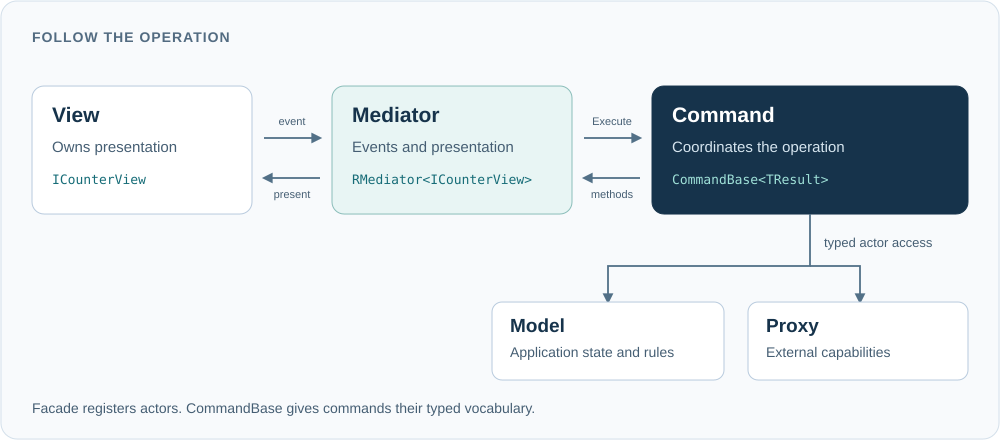
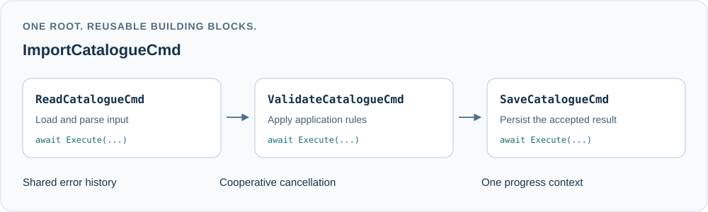

# RMVC

**Readable, navigable, compiler-checked application workflows.**

RMVC is a small MVC framework for C# applications. It puts application decisions in
explicit commands, keeps state and external services behind clear boundaries, and
lets your views own presentation.

An operation has a route you can follow: a view raises an event, a mediator submits
a command, and that command coordinates the models, proxies and presentation it
needs. The calls and payloads are typed. Your IDE can take you through the journey.
Work can also start from a model's meaningful state change or a host entry point;
application operations remain explicit whichever direction they originate from.

[Why RMVC?](#what-makes-rmvc-different) · [Quickstart](#get-started-a-complete-counter) ·
[Command composition](#compose-workflows-from-reusable-commands) · [Lifecycle](#lifecycles-and-boundaries-are-explicit)



## What makes RMVC different?

- **Commands are where actors meet.** Framework actor lookup is available inside
  commands. Models and mediators submit operations; the facade declares the
  application and exposes entry points. Coordination has a clear home.
- **Your `CommandBase` defines the application's vocabulary.** Give your commands
  named, typed accessors for the capabilities they use. Concrete operations then
  read as application behaviour, with their dependencies one navigation step away.
- **Commands are reusable building blocks.** Run a command as an independent
  operation or await it inside another command. Nested work shares the root's
  error history, cooperative cancellation and progress context.
- **Presentation and integration boundaries are replaceable.** Keep the contracts;
  supply different views and proxies for another environment. The application
  decisions do not need to move into the new UI framework.

RMVC can sit alongside MVVM presentation and has also been used with Unity's
component model. MVVM can handle presentation and binding while RMVC structures
application operations; these responsibilities can coexist.

## A few actors, with distinct jobs

| Part | Responsibility |
| --- | --- |
| **Facade** | Registers the application's models and mediators and creates its initialisation command. Public entry points submit commands. |
| **Model** | Owns application state and rules. Use `RModel`, or implement `IRModel` when adapting an existing class. |
| **Proxy** | A model that provides access to an external capability: a database, filesystem, service or native library. There is no separate `RProxy` base. |
| **Command** | Coordinates an application operation through typed actor access. Commands can take input and return typed results. |
| **Mediator** | Connects an attached object's contract to commands and exposes typed presentation methods. It does not own application state. |
| **View** | Implements its contract and owns UI components, rendering, local interaction and UI-thread dispatch. |
| **Shell** | Supplies host capabilities and decisions, and observes lifecycle state. Every application supplies one, including a non-interactive host. |

A mediator can exist before its view. That distinction is useful during development,
for delayed UI creation, and when the same application supports different forms of
presentation. Mediators are not limited to visual objects; their attachment is defined
by an `IRContract` interface.

A view can own a sophisticated set of grids, editors, repeated cards and local
interactions behind one contract. Its components can coordinate locally; application
actions cross the contract into commands. Commands supply meaningful information and
requests, while the view chooses how to present them. `RModel` can likewise initiate
follow-up commands when its own state changes; models need not be passive containers.

## Get started: a complete counter

This example uses the **current repository API**. The library targets **.NET Standard
2.0**; this runnable console host uses the .NET 9 SDK. Published packages and older
sample projects may use an earlier API.

From a checkout of this repository:

```sh
dotnet new console --name CounterDemo --output ../RMVC.CounterDemo --framework net9.0
dotnet add ../RMVC.CounterDemo/CounterDemo.csproj reference RMVC/RMVC.csproj
```

### 1. Define the application

Create `CounterApp.cs` in the new console project. The facade registers the actors;
the application `CommandBase` names them; the commands describe what happens.

<!-- quickstart:CounterApp.cs -->
```csharp
using System;
using System.Threading;
using System.Threading.Tasks;
using RMVC;

namespace CounterDemo;

public interface ICounterView : IRContract
{
    event Action? IncrementRequested;
    void SetCount(int count);
}

internal sealed class CounterModel : RModel
{
    private int count;
    public int Count => Volatile.Read(ref count);
    public int Increment() => Interlocked.Increment(ref count);
}

internal sealed class CounterMediator : RMediator<ICounterView>
{
    protected override void ActorAttached(ICounterView actor)
        => actor.IncrementRequested += OnIncrement;

    protected override void ActorDetached(ICounterView actor)
        => actor.IncrementRequested -= OnIncrement;

    private void OnIncrement() => Execute(new IncrementCountCmd());

    public void SetCount(int count)
        => WithActor(view => view.SetCount(count));
}

internal abstract class CommandBase<TResult> : RCommand<TResult>
{
    protected CounterModel Counter => Model<CounterModel>();
    protected CounterMediator CounterMediator => Mediator<CounterMediator>();
}

internal sealed class IncrementCountCmd : CommandBase<RVoid>
{
    protected override Task<RVoid> Run()
    {
        int count = Counter.Increment();
        CounterMediator.SetCount(count);
        return Complete();
    }
}

internal sealed class InitialiseCmd : CommandBase<RVoid>
{
    protected override Task<RVoid> Run()
    {
        CounterMediator.SetCount(Counter.Count);
        return Complete();
    }
}

public sealed class CounterFacade : RFacade
{
    protected override IRModel[] RegisterModels()
        => new IRModel[] { new CounterModel() };

    protected override RMediator[] RegisterMediators()
        => new RMediator[] { new CounterMediator() };

    protected override RCommandBase CreateInitialiseCommand(
        IRInitialisation? initialisation) => new InitialiseCmd();
}
```

`RVoid` means the command has no result; `Complete()` supplies the completed task
returned from `Run()`.
The useful centre is `IncrementCountCmd`: update the model, then pass its result to
presentation. It knows the mediator's methods, not the concrete UI. `WithActor`
retains presentation calls until an object is attached; capture immutable data in
those calls. The mediator subscribes on attachment and unsubscribes on detachment,
without retaining another copy of the view.

### 2. Supply a host and a view

Replace `Program.cs` with this. Here, the view prints a number; in a GUI it could
update a label or a richer component. The application file above stays the same.

<!-- quickstart:Program.cs -->
```csharp
using CounterDemo;
using RMVC;

var shell = new ConsoleShell();
RFacade.Create<CounterFacade>(shell);

var view = new ConsoleCounter();
RFacade.RegisterActor<CounterFacade, ICounterView>(view);

Console.WriteLine("Enter: increment. q: quit.");
while (Console.ReadLine() is string input && input != "q")
    view.Increment();

RFacade.UnregisterActor<CounterFacade, ICounterView>(view);
try
{
    await RFacade.Shutdown(5000);
}
catch (Exception error)
{
    Console.Error.WriteLine(error.Message);
    Environment.ExitCode = 1;
}

sealed class ConsoleCounter : ICounterView
{
    public event Action? IncrementRequested;
    public void Increment() => IncrementRequested?.Invoke();
    public void SetCount(int count) => Console.WriteLine($"Count: {count}");
}

sealed class ConsoleShell : IRShell
{
    public void HandleStateChanged(RApplicationState state, string? message = null)
        => Console.WriteLine($"RMVC: {state} {message}");

    public bool ShowMessageBox(string title, string message, bool isYesNo = false)
    {
        Console.WriteLine($"{title}: {message}");
        return !isYesNo; // This host acknowledges messages and declines confirmations.
    }
}
```

Run it:

```sh
dotnet run --project ../RMVC.CounterDemo/CounterDemo.csproj
```

You will see `Count: 0`. Press Enter to increment; enter `q` to shut down.
Initialisation runs in the background, and ordinary command submissions wait until
it succeeds. Presentation may be prepared before view attachment. In a GUI,
register/unregister the view at the appropriate points in the host's lifecycle.

## Compose workflows from reusable commands

A command is a useful unit of behaviour in its own right. Larger operations can reuse
those units as awaited children, including children that themselves compose commands.



For example, add this class to `CounterApp.cs`:

<!-- quickstart:IncrementTwiceCmd.cs -->
```csharp
internal sealed class IncrementTwiceCmd : CommandBase<RVoid>
{
    protected override async Task<RVoid> Run()
    {
        await Execute(new IncrementCountCmd(), percentCap: 50);
        if (ErrorOrAbort)
            return await Complete();

        await Execute(new IncrementCountCmd(), percentCap: 50);
        return await Complete();
    }
}
```

Change the mediator's `OnIncrement` to submit `new IncrementTwiceCmd()` and the same
view action now runs the composed operation. Each child contributes up to half of
its parent's progress. Commands can also return a `TResult`, which a parent receives
from `await Execute(...)`.

Prefer **one root command per initiating event**. Within a command, awaited children
share its execution context. Separate `Execute(...)` calls from a mediator, model or
facade submit independent work and can overlap; they do not form an implicit queue.
Create command instances at the call site and use each instance once. Accept immutable
input through constructors; return typed results or publish model state. Do not expose
command fields/properties for other code to inspect after asynchronous submission.

RMVC records command errors in the root's error history. Check `ErrorOrAbort` before
proceeding to dependent steps. Cancellation is cooperative: check
`ThrowIfAbortRequested()` during long work and after a decision before changing state.

> RMVC orchestrates application workflows, while developers own the thread safety
> of models and actors. Its portability comes from preserving that separation.

The counter uses atomic reads/increments for that reason. Real views own their UI
thread; proxies and models own the concurrency requirements of their resources.

## Keep user journeys separate from running work

A command can load data, update models and populate a review screen, then finish.
The user may spend minutes reviewing it. Save or Cancel is a later event that submits
a new command with the relevant immutable input.

Immutable data is essential at these boundaries. The counter passes an `int`; richer
journeys should pass owned, immutable snapshots. A read-only collection interface does
not freeze a caller's mutable list or its elements. Models and views can own mutable
working state; the data they exchange must have a stable meaning after submission.

Ending the command at the review boundary keeps progress reporting about work
actually happening, and avoids retaining a command while a mediator waits for a
future user action. Awaiting IO or applying a
necessary UI update is different from awaiting an entire interactive session.

The default Shell `ShowMessageBox` is a deliberate narrow exception: a synchronous
decision holds its command until answered. Async-only hosts should supply an
application-specific async capability rather than blocking their event loop to
imitate a synchronous prompt.

## Lifecycles and boundaries are explicit

- **Create once.** `RFacade.Create<TFacade>(shell)` registers actors and starts
  initialisation. Ordinary roots wait for success. A second creation attempt throws,
  including after failed startup; restarting the runtime requires a new process.
- **Require what matters.** `Model<T>()` and `Mediator<T>()` return a unique matching
  registered instance, including subclasses, and throw on absence or ambiguity.
  Registration is checked at runtime; typed code does not prove every registration
  exists. Optional lookups and interface contracts express deliberate alternatives.
- **Keep construction light.** Acquire resources deliberately during application
  initialisation or operations. Models implement `Cleanup()`; `RModel` supplies a
  no-op default. Release only resources you own, including when initialisation acquired
  only some of them.
- **Shut down deliberately.** Hosts can await `RFacade.Shutdown(milliseconds)` or
  discard the task and observe Shell state. It closes admission, cancels and drains
  work, then cleans models within the budget. Timeout or cleanup failure faults the
  task and reports `Failed`; it cannot forcibly stop arbitrary code or certify release
  after failure. The host owns process exit.

A command that needs to await terminal shutdown uses inherited
`await Shutdown(milliseconds)`. RMVC preserves that root solely for Shell interaction
and local completion. After calling, **do not use models, proxies, mediators or cached
actor references—even to write a log**. Other actor lookups and child execution are
rejected from that root. Do not await the static facade method from inside a command.

A registered mediator can still have no attached view. Actor registration,
presentation readiness and external-resource readiness are different facts.

## Built for an application that outlives its first platform

A language, runtime or UI platform can disappear. RMVC treats that possibility as an
architectural assumption: preserve understandable application decisions, contracts
and workflows when the original technology is replaced.

Views and proxies are the environmental boundaries. Expect to replace their concrete
implementations when changing hosts; preserve well-designed contracts, application
state and operations wherever possible. The C# library itself has no UI-framework
dependency. Portability is a design constraint, beyond the choice of target framework:
core mechanisms should have credible equivalents in other major languages, with
recognisable responsibilities and control flow to support knowledge transfer.

The aim is to support an application's evolution from an interactive research project
to a deployed GUI, an automated workflow or a headless service. Those forms can share
application operations while supplying different presentation and host policies.
This repository supplies the C# implementation targeting `.NET Standard 2.0`; it does
not promise maintained ports or verified integrations on every platform.

`IRModel` gives existing classes an adaptation route: implement `Cleanup()`, establish
clear contracts and migrate a complete operation. The work still includes untangling
the application's existing boundaries; incremental adoption is an option to evaluate,
not a promise of effortless integration.

## Source and next steps

The [core library](RMVC) is small enough to explore directly. Start with
[`RCommandBase`](RMVC/RCommandBase.cs), [`RFacade`](RMVC/RFacade.cs) and
[`RMediator`](RMVC/RMediator.cs). A good next exercise is replacing the console view
while preserving the application's contracts, model and commands.

For human developers and coding assistants alike: before extending an RMVC application,
read its `CommandBase`, facade registrations and actor contracts. They describe the
capabilities and boundaries through which the next operation should be expressed.

The [README verification](Tests/RMVC.ReadmeChecks/verify.py) builds and runs the code
on this page, including the composed-command variation. Existing repository samples
await migration to the current API; use this quickstart as the starting reference.

[MIT licensed](LICENSE).
